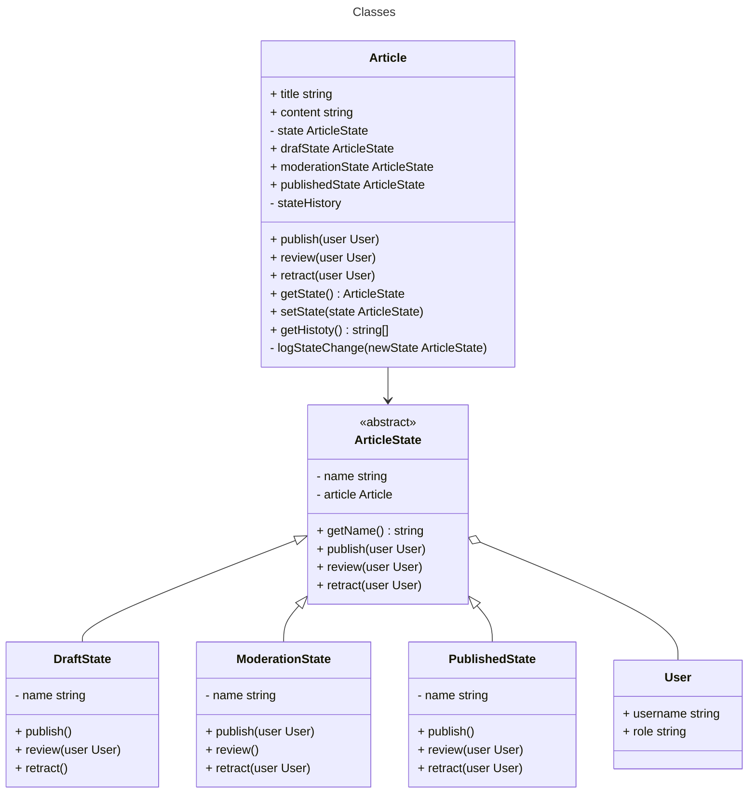

# Solved: Editorial workflow

## Class Diagram



## Execute

```bash
$ npm run execute:solved editorial-workflow
```

## Tests

### Unit and integration tests

```bash
$ npm run test:unit:problem editorial-workflow
```

### Mutation test

```bash
$ npm run test:mutation:problem editorial-workflow
```
